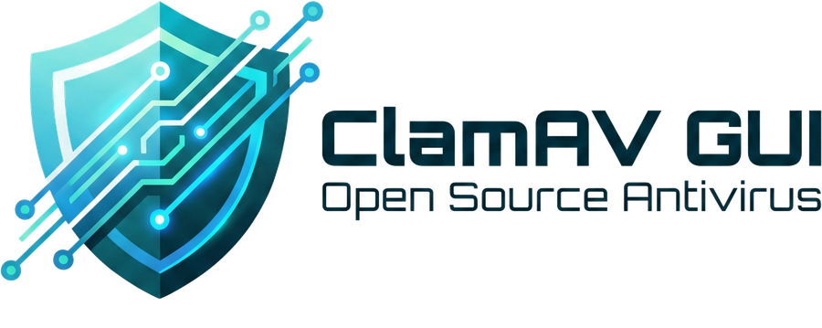
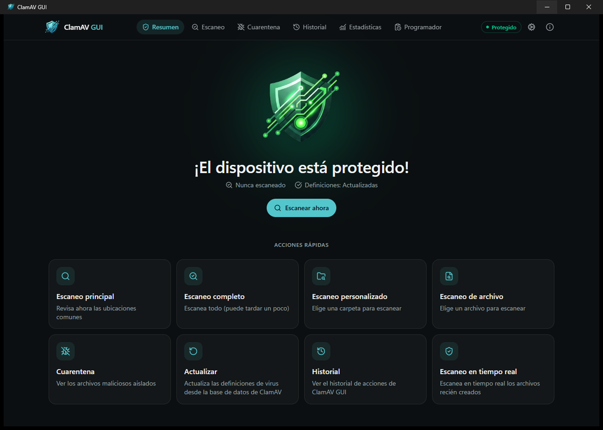
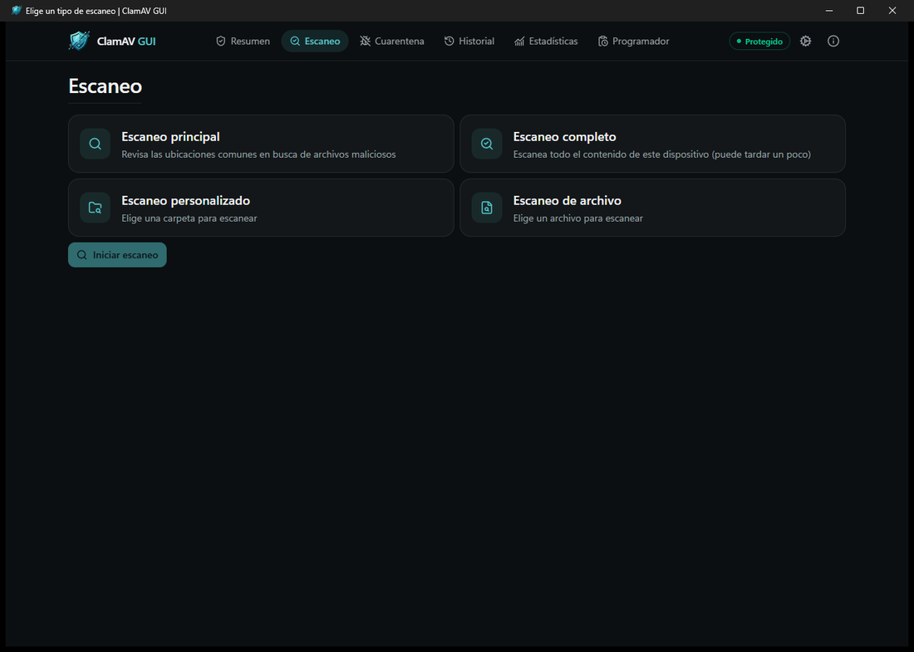
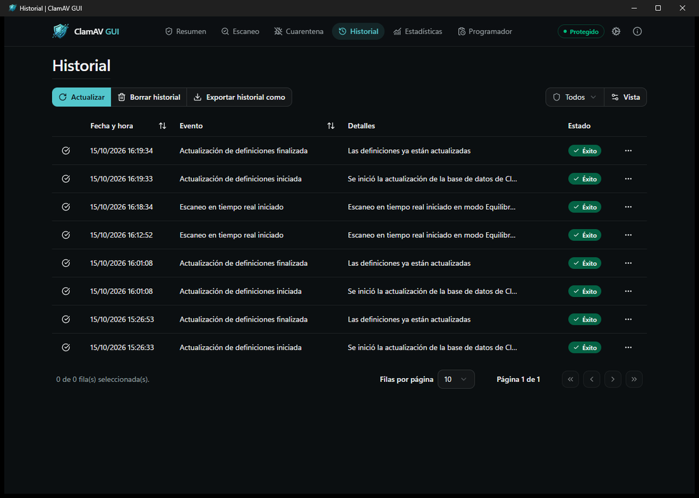
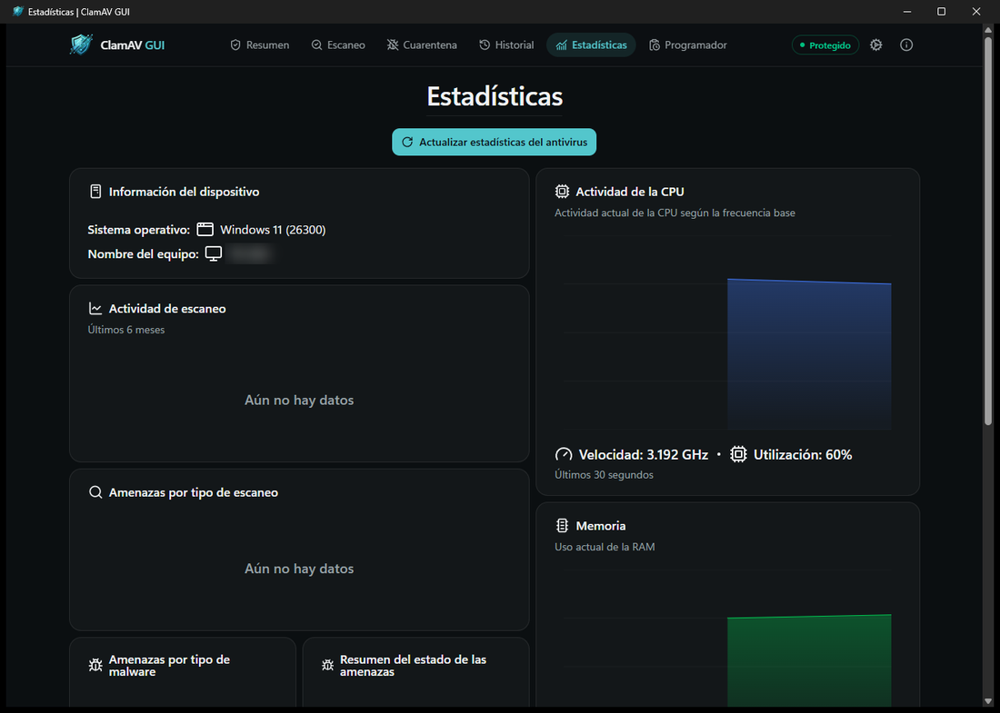
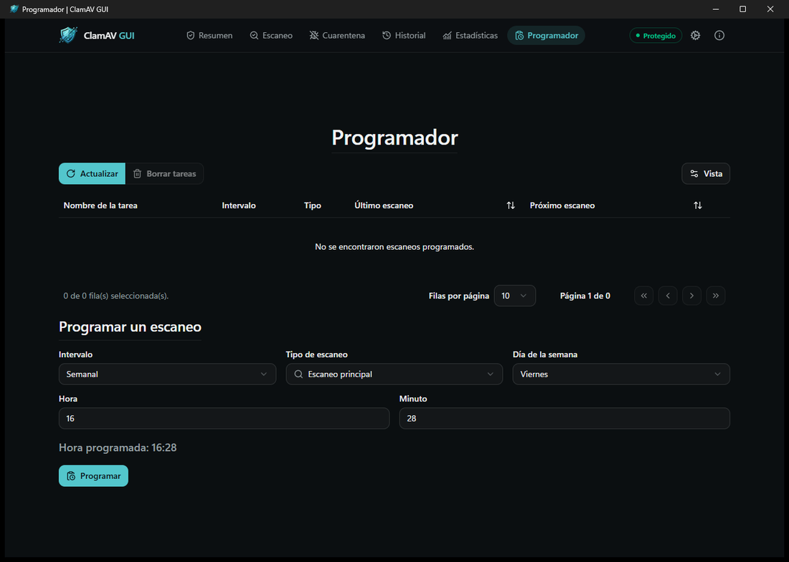
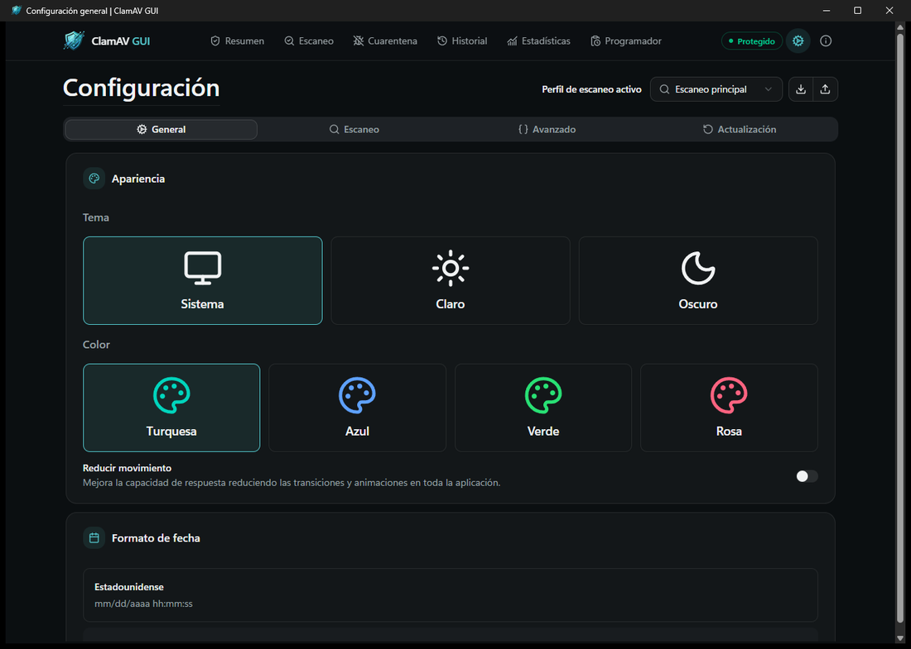
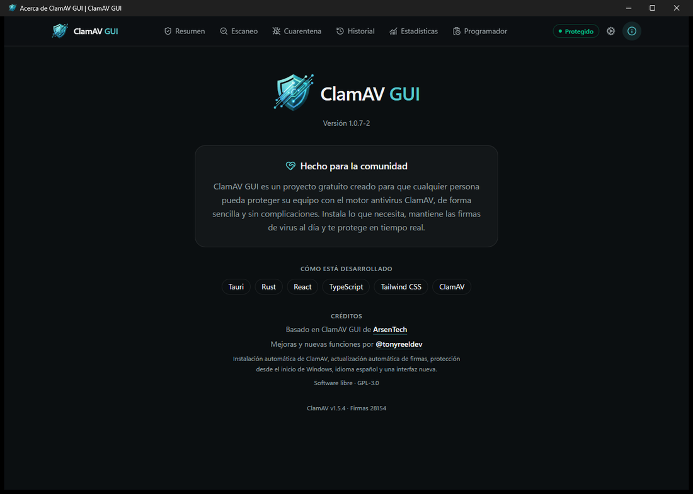

<p align="center">
  
</p>

<p align="center">
  <b>Antivirus gratuito y de código abierto para Windows, con el motor de <a href="https://www.clamav.net/">ClamAV</a>.</b><br>
  Se instala, se configura y se mantiene actualizado solo.
</p>

<p align="center">
  <a href="../../releases/latest"><b>⬇️ Descargar para Windows</b></a>
</p>

<p align="center">
  
</p>

---

## ¿Qué es?

**ClamAV GUI** es una interfaz de escritorio sencilla para [ClamAV](https://www.clamav.net/), el motor antivirus libre de Cisco Talos. ClamAV es potente pero funciona por línea de comandos; esta app lo hace fácil de usar para cualquier persona:

- **Sin configuración manual.** Si ClamAV no está instalado, la app lo instala sola. Descarga y actualiza las firmas de virus por su cuenta.
- **Protección continua.** Arranca con Windows (oculta en la bandeja del sistema) y vigila tus archivos en tiempo real.
- **Gratis y para la comunidad.** Sin anuncios, sin cuentas y sin recopilar datos.

## Características

| | |
|---|---|
| 🛡️ **Protección en tiempo real** | Vigila tus carpetas y escanea los archivos nuevos o modificados. Te avisa con una notificación y, según el modo, pone la amenaza en cuarentena. |
| 🔎 **Escaneos** | Principal (ubicaciones comunes), completo, de una carpeta o de un archivo concreto. |
| 🔄 **Firmas siempre al día** | Actualiza la base de virus al iniciar y cada 4 horas, sin pedir permisos de administrador. |
| ⚙️ **Instalación automática de ClamAV** | Si falta, lo instala con `winget` (paquete oficial de Cisco). Solo pide confirmar la ventana de permisos de Windows (UAC). |
| 🚀 **Inicio con Windows** | Se abre minimizada en la bandeja al encender el equipo. Se puede desactivar. |
| 🗂️ **Cuarentena e historial** | Restaura o elimina archivos aislados y revisa todo lo que hizo el antivirus. |
| 🧱 **Seguridad de Windows** | Panel en la pantalla principal que muestra si el firewall, Microsoft Defender, la protección de red, la protección contra ransomware y SmartScreen están activos, y abre su configuración. |
| 📊 **Estadísticas** | Amenazas por tipo, actividad de escaneo y uso de CPU, memoria y disco. |
| ⏰ **Escaneos programados** | Diarios, semanales o mensuales con el Programador de tareas de Windows. |
| 🌐 **Idiomas** | Español e inglés (además de francés, polaco, ruso, armenio y chino). |
| 🎨 **Temas** | Claro, oscuro o según el sistema, con varios colores de acento. |

## Capturas

<table>
  <tr>
    <td align="center"><br><sub>Tipos de escaneo</sub></td>
    <td align="center"><br><sub>Historial</sub></td>
  </tr>
  <tr>
    <td align="center"><br><sub>Estadísticas</sub></td>
    <td align="center"><br><sub>Escaneos programados</sub></td>
  </tr>
  <tr>
    <td align="center"><br><sub>Configuración</sub></td>
    <td align="center"><br><sub>Acerca de</sub></td>
  </tr>
</table>

## Instalación

1. Descarga `ClamAV-GUI_x.x.x_x64-setup.exe` desde [Releases](../../releases/latest).
2. Ejecútalo y sigue el asistente.
3. Abre la app. Si ClamAV no está instalado, la app lo instalará (acepta la ventana de permisos de Windows). Después descargará las firmas de virus; la primera vez son unos 110 MB.

Listo. A partir de ahí se inicia sola con Windows y se mantiene actualizada.

> **Requisitos:** Windows 10 u 11 de 64 bits y conexión a internet para descargar ClamAV y las firmas. La instalación automática usa `winget`, incluido en Windows 10/11 actuales; si tu equipo no lo tiene, la app muestra los pasos para instalar ClamAV a mano.

### Modos de protección en tiempo real

Se cambian en **Configuración → Avanzado → Comportamiento**:

| Modo | Qué vigila | Si detecta algo |
|---|---|---|
| **Equilibrado** (por defecto) | Ejecutables, scripts, PDF y ZIP | Lo pone en cuarentena y avisa |
| **Seguro** | Ejecutables y scripts | Solo avisa |
| **Estricto** | Lo anterior y archivos de texto; reescanea al modificarse | Lo pone en cuarentena y avisa |
| **Experto** | Todos los archivos | Solo avisa |

Mientras está activa, la protección mantiene las firmas cargadas en memoria con `clamd`, el servicio de ClamAV. Así cada archivo se revisa en milisegundos, a cambio de cerca de 1 GB de RAM. Al desactivarla, esa memoria se libera.

## Preguntas frecuentes

**¿Envía mis archivos o datos a algún sitio?**
No. Todo el escaneo ocurre en tu equipo. La app solo se conecta a internet para descargar ClamAV y las firmas de virus desde los servidores oficiales de ClamAV.

**¿Reemplaza a Windows Defender?**
No, y no hace falta desactivarlo. ClamAV GUI analiza archivos por firmas y funciona al lado de Defender como segunda opinión.

**¿Protege contra ataques de red o webs maliciosas?**
No por sí mismo: ClamAV solo analiza archivos. Esa protección la dan el firewall de Windows, la protección de red de Defender y SmartScreen. El panel **Seguridad de Windows** de la pantalla principal muestra si están activos y lleva a su configuración. La protección de red no tiene interruptor en Windows, así que el panel muestra el comando para activarla.

**¿Dónde guarda sus datos?**

| Qué | Dónde |
|---|---|
| Firmas de virus y configuración de ClamAV | `%LOCALAPPDATA%\com.clamavgui.app\clamav\` |
| Ajustes, historial, registros y cuarentena | `%APPDATA%\com.clamavgui.app\` |

**¿Cómo la desinstalo?**
Desde *Configuración de Windows → Aplicaciones*, como cualquier otro programa. ClamAV se desinstala por separado.

## Compilar desde el código

Necesitas [Node.js](https://nodejs.org/) 20 o superior, [Rust](https://rustup.rs/) y, en Windows, [Visual Studio Build Tools](https://visualstudio.microsoft.com/visual-cpp-build-tools/) con *Desarrollo de escritorio con C++*.

```bash
git clone https://github.com/tonyreeldev/clamav-gui.git
cd clamav-gui
npm install
npm run tauri dev     # ejecutar en modo desarrollo
npm run tauri build   # generar el instalador
```

El instalador queda en `src-tauri/target/release/bundle/nsis/`.

Pruebas:

```bash
cd src-tauri && cargo test --lib   # backend
npx tsc --noEmit                   # tipos del frontend (desde la raíz)
```

### Publicar una versión

Los instaladores se compilan en local y se publican a mano. El workflow de GitHub solo comprueba que compila, y solo en los pull requests.

1. **Subir la versión** (por ejemplo `1.0.9`) en `package.json`, `package-lock.json` (las dos primeras apariciones), `src-tauri/Cargo.toml` y `src-tauri/tauri.conf.json`.
2. **CHANGELOG:** en `CHANGELOG.md`, renombrar `## Sin publicar` a `## 1.0.9 — AAAA-MM-DD`.
3. **Comprobar y compilar:**
   - `cargo test --lib`
   - `npx tsc --noEmit`
   - `npm run tauri build`
4. **Probar el instalador.** Primero cierra la app desde la bandeja (solo permite una instancia), instala el `.exe` nuevo y prueba:
   - un escaneo
   - el tiempo real
   - la cuarentena
5. **Commit y etiqueta:**
   ```bash
   git commit -am "Versión 1.0.9"
   git tag v1.0.9
   git push origin main v1.0.9
   ```
6. **Lanzamiento** con el instalador renombrado a `ClamAV-GUI_1.0.9_x64-setup.exe` (sin espacios):
   ```bash
   gh release create v1.0.9 ClamAV-GUI_1.0.9_x64-setup.exe --title "ClamAV GUI v1.0.9" --notes-file notas.md --latest
   ```
   Las notas siguen el formato de los lanzamientos anteriores: descarga, requisitos, novedades, aviso de SmartScreen y créditos.

Cada cambio va en una versión nueva: no se reemplaza el instalador de un lanzamiento ya publicado.

### Cómo está hecho

| Parte | Tecnología |
|---|---|
| Aplicación de escritorio | [Tauri 2](https://tauri.app/) (Rust) |
| Interfaz | React 19, TypeScript, Tailwind CSS 4, componentes Radix/shadcn |
| Motor antivirus | `clamscan` (escaneos manuales), `clamd` (tiempo real) y `freshclam` (firmas) de ClamAV |
| Tiempo real | Vigilancia de archivos con `notify` (Rust) |

```
src/                 Interfaz (React)
src-tauri/src/       Lógica de escritorio (Rust): escaneos, cuarentena, actualización, tiempo real
public/locales/      Traducciones de la interfaz
src-tauri/assets/    Iconos de estado, traducciones de la bandeja e imágenes del instalador
```

## Contribuir

¿Encontraste un error o tienes una idea? Abre un [issue](../../issues). Los pull requests son bienvenidos; si añades textos nuevos a la interfaz, incluye al menos la traducción al español y al inglés.

## Créditos

- Basado en [ClamAV GUI](https://github.com/ArsenTech/clamav-gui) de ArsenTech.
- Mejoras y nuevas funciones por [@tonyreeldev](https://github.com/tonyreeldev).
- ClamAV® es una marca de Cisco Systems, Inc. Este proyecto es independiente y no está afiliado a Cisco.

Software libre bajo la licencia GPL-3.0 (ver [LICENSE.md](LICENSE.md)).
